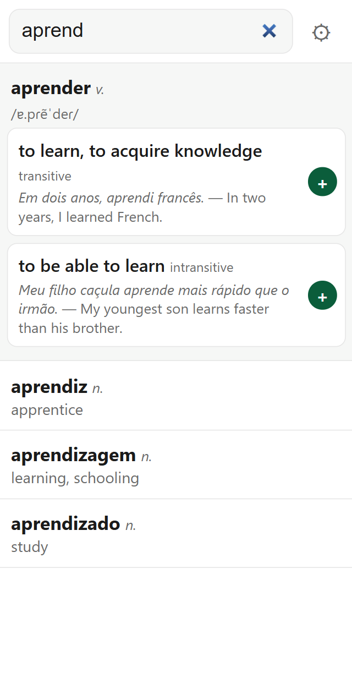
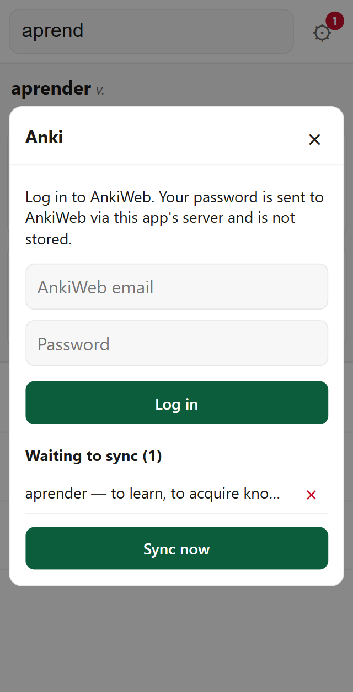

# ptwords

Progressive Web App (PWA) for quickly looking up new (European) Portuguese words and syncing them to an AnkiWeb deck.

The dictionary is built from [kaikki.org](https://kaikki.org/dictionary/Portuguese/), which in turn sourced its data from Wiktionary. 




## Features

* Instant dictionary search
* Offline support (words to sync saved once reconnected)
* AnkiWeb syncing
* Matches conjugations to base form/infinitive

## Architecture

Cloudflare Workers. App is mostly local-only; the backend provides:

* AnkiWeb proxy (due to CORS) -- credentials never saved (session tokens stored in localStorage)
* Dictionary assets

## Development

```sh
npm install
npm run dict:fetch            # ~600 MB download into data/
npm run dict:build            # -> out/ptdict-<hash>.bin + out/dict.json (the build bundles it)

npm run dev                   # start local dev server
npm run deploy                # cf deploy (builds first)
```

_Note_: [mise](https://mise.jdx.dev/) used for tool management. If you haven't used it before, I highly, highly recommend it.
